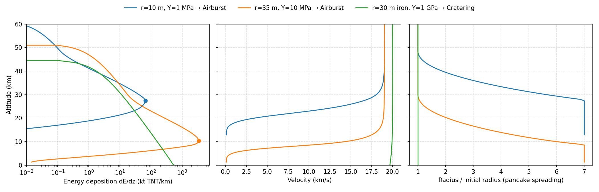
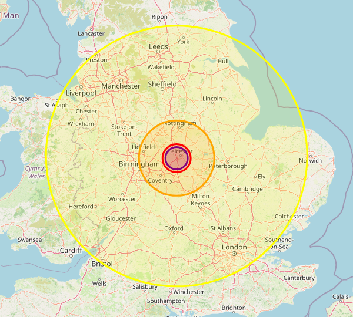

# DeepImpact: Asteroid Airburst & Impact Risk Modelling

A Python package that models an asteroid entering Earth's atmosphere. A fourth-order Runge–Kutta (RK4) solver integrates the coupled equations for drag, ablation, lift, gravity and pancake-style fragmentation. It then classifies the event as an airburst or a ground impact. A mapping tool turns the result into blast-damage zones over the UK and estimates the exposed population.

<p align="center">
  
  <br><em>Solver output for three scenarios: a weak 10 m stony body and a 35 m body both airburst (dots mark the peak energy deposition), while a 30 m iron body survives to the ground.</em>
</p>

## Features

- **Atmospheric-entry solver** (`Planet.solve_atmospheric_entry`). Returns the full trajectory history as a `DataFrame`: velocity, mass, trajectory angle, altitude, horizontal distance, radius, and spreading rate after fragmentation onset.
- **Energy deposition** (`Planet.calculate_energy`). Adds the kinetic-energy loss per unit altitude, dE/dz in kt TNT/km.
- **Outcome analysis** (`Planet.analyse_outcome`). Returns five quantities:
  - event type: `Airburst` or `Cratering`
  - burst altitude, the altitude of peak energy deposition
  - peak dE/dz
  - burst energy (kt TNT)
  - horizontal distance travelled before the burst
- **Atmosphere models**: exponential (default), tabulated, or constant density.
- **Damage mapping**: converts the burst into airblast overpressure radii and plots them over the UK, together with postcode-level population exposure.

<p align="center">
  
  <br><em>Airblast damage zones for one impact scenario. Each ring is an overpressure threshold.</em>
</p>

## Installation

Requires Python ≥ 3.13.

```bash
pip install -e .
python download_data.py   # UK postcode, census-population and atmosphere tables → resources/
```

## Quick start

```python
import deepimpact

earth = deepimpact.Planet()  # exponential atmosphere by default

result = earth.solve_atmospheric_entry(
    radius=35, velocity=19e3, density=3000, strength=1e7, angle=45
)
result = earth.calculate_energy(result)
outcome = earth.analyse_outcome(result)

print(outcome)
# {'outcome': 'Airburst', 'burst_altitude': ..., 'burst_peak_dedz': ...,
#  'burst_distance': ..., 'burst_energy': ...}
```

To plot dE/dz, kinetic energy and the trajectory against altitude:

```python
from deepimpact.plot_graphs import plot_altitude_energy

plot_altitude_energy([result])
```

To map the damage zones and estimate exposed population:

```python
blat, blon, radii = deepimpact.damage_zones(
    outcome, lat=52.79, lon=-2.95, bearing=135, pressures=[1e3, 4e3, 30e3]
)  # surface-zero location and blast radius (m) for each overpressure (Pa)

locator = deepimpact.GeospatialLocator()
locator.get_population_by_radius((blat, blon), radii)
# [15463333, 2976096, 5661]  → people inside each damage zone

fmap = None
for r in radii:
    fmap = deepimpact.plot_circle(blat, blon, r, fmap=fmap)
fmap.save("damage_map.html")  # interactive folium map
```

`deepimpact.impact_risk(planet, impact_file)` runs an uncertainty analysis over a CSV of sampled impact scenarios (radius, angle, velocity, strength, density, entry location, bearing). It returns the probability that each postcode falls inside the blast radius, plus the mean and standard deviation of the affected population.

There is a runnable example in `examples/example.py`:

```bash
python examples/example.py
```

## Numerical method

- **Integrator.** RK4 on the state vector (velocity, mass, angle, altitude, distance, radius). RK4 stays stable through rapid deceleration and fragmentation, where lower-order schemes oscillate.
- **Time steps.** The integration step `dt` (default 0.005 s) is separate from the output sampling step `output_dt` (default 0.05 s). This keeps the returned table small without losing accuracy. Increasing `dt` makes runs faster but can smear sharp features such as pancaking onset.
- **Fragmentation.** Once the ram pressure exceeds the material strength, the radius grows according to the pancake model. Growth is capped at `pancake_factor` × the initial radius (default 7).
- **Termination.** The run stops when the body reaches the ground, ablates completely, or its velocity, mass and distance stop changing.

## Testing

```bash
pytest tests/
```

The suite covers the solver (checked against a reference scenario in `tests/scenario.npz`), the damage-radius calculations and the postcode/population locator. Run `download_data.py` first. On every push, CI runs the tests along with `black` and `ruff`.

## Documentation

Build the Sphinx docs (HTML) with:

```bash
python -m sphinx docs/source docs/html
```

## Credits

Built by **Team Ceres** (6 members) for the Applied Computational Science & Engineering group project at Imperial College London, November 2025. See `references.md` for sources and AI-assistance disclosures.

## License

MIT, see [LICENSE](LICENSE).
